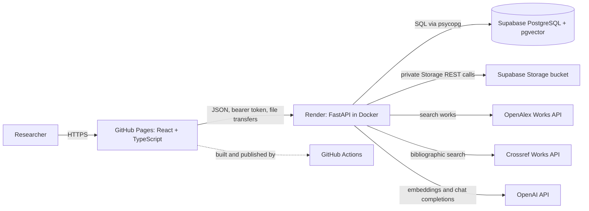

# Fieldnotes architecture and feature inventory

This document describes the application as implemented. It is the reference for the current system design, external services, API surface, and actions available to users; it is not a roadmap or the original project sketch.

## At a glance

Fieldnotes is a browser-based research workspace. The browser serves the React application and sends authenticated HTTPS requests to a FastAPI service. The API owns authentication, project access checks, collaboration, document processing, academic-search integration, retrieval, and AI calls. Research data and literature metadata are stored in PostgreSQL; original uploads are stored in a private file store.

### Browser navigation and responsive layout

The persistent desktop sidebar switches between personal/team workspaces and their projects; project content is organized in labeled section tabs for Documents, Literature, Notes, Main document, and Ask & explore. The top toolbar exposes labeled inbox, workspace, channel, and project actions. At phone widths, the sidebar becomes a dismissible navigation drawer opened from the top bar, with a close control, backdrop dismissal, and Escape-key support. Python file creation and editing are role-gated; read-only collaborators receive an inline explanation of the access needed to change scripts.

The browser API client retries network-level failures for idempotent GET requests with bounded delays to tolerate API wake-up after inactivity. It does not retry writes or HTTP error responses; if a read still cannot reach the API, the client displays a connection error.

## Architecture and hosting

| Layer | Technology/service | Responsibility |
|---|---|---|
| Web client | React 18, TypeScript, Vite, CodeMirror 6 | Login and registration, account profile/settings and AI usage, personal and organization team workspaces, role-based project sharing, workspace/project channels and direct messages, document and paper views, project-wide source comments and cached AI summaries, LaTeX editor/PDF compilation, a project-files Python analysis editor, assistant review UI, cited research brief export, and project backup bundles. |
| Static web hosting | GitHub Pages | Serves the built frontend at `https://grace-pasion.github.io/ai-research-assistant/`. It does not host the API, database, or documents. |
| Build and publish | GitHub Actions | Installs frontend dependencies, runs Vitest, builds the static site, and publishes it to Pages on pushes to `main` or a manual workflow run. `VITE_API_URL` can be overridden with a repository Actions variable; otherwise the workflow uses the configured Render API URL. |
| Admin portal | Separate React view at `?portal=admin` | Uses the same frontend bundle, but a separate login screen and isolated browser token. The backend grants administrator access only to existing accounts listed in `ADMIN_EMAILS`. |
| Backend API | Python 3.12, FastAPI, SQLAlchemy, Uvicorn, Docker | Provides the JSON API, bearer-token authentication, authorization, processing, storage access, and integrations. |
| API hosting | Render Web Service (Docker) | Runs the API. The service may sleep on the free plan; the health endpoint is `/api/health`. |
| Hosted database | Supabase PostgreSQL with the `vector` extension | Stores accounts, team workspaces/memberships/channels/messages, projects, document text/chunks and embeddings, conversations, usage counters, and literature metadata. The Render configuration uses `DATABASE_URL`; `LITERATURE_DATABASE_URL` defaults to the same URL unless separately configured. |
| Hosted file storage | Supabase Storage, private `research-documents` bucket | Stores original uploaded files. The API accesses the bucket using its server-side Supabase key; the browser does not access the bucket directly. |
| Local development | Docker Compose, PostgreSQL 16 with pgvector | Runs the Vite development server, API, and PostgreSQL. Local Compose initializes separate `research_db` and `literature_db` databases and stores uploads in a Docker volume. Local file storage is also supported. |

### Backend organization

- `backend/app/main.py` creates the FastAPI application, CORS policy, database engines/session factories, startup schema initialization, and route registration.
- `backend/app/routers/` implements authentication, administrator, projects, collaboration and messaging, documents, papers, annotations, LaTeX and Python writing workspaces, usage, and assistant endpoints.
- `backend/app/services/` implements academic search, extraction/chunking, document processing, local/Supabase file storage, Python output validation, AI retrieval/generation, activity recording, and atomic sign-in/daily prompt limits.
- `backend/app/models.py` defines separate SQLAlchemy metadata for research data and literature data. The literature models use their own session factory even when both URLs point at the same physical PostgreSQL database.
- `backend/app/config.py` loads backend settings from environment variables (and `.env` for local development). OpenAI, database, JWT, and Supabase credentials belong on the backend, never in the frontend.

Document processing uses FastAPI in-process background tasks, not a durable external queue. Render runs Uvicorn with proxy-header support so the API can apply its client-IP prompt limit behind Render's proxy.

## External APIs and integrations

| Provider | API used | What Fieldnotes sends/receives |
|---|---|---|
| OpenAlex | `https://api.openalex.org/works` | Topic search and result metadata, including title, abstract, authors, year, DOI, venue, citation count, landing-page URL, and open-access PDF locations. Saved-paper full-text imports use OpenAlex's open-access status and PDF URL; downloads are size-limited and restricted to public HTTPS hosts. Chat paper discovery also uses OpenAlex. The optional backend `OPENALEX_API_KEY` is sent as an Authorization bearer token to use the account's higher API budget; optional `OPENALEX_EMAIL` identifies requests. |
| Crossref | `https://api.crossref.org/works` | Bibliographic query and result metadata, including DOI, title, abstract when available, authors, publication year, venue, and citation count. |
| OpenAI | Embeddings API and Chat Completions API, called through the Python SDK | Creates document/query embeddings, semantically re-ranks academic search candidates using paper titles and abstracts, generates structured answer claims, checks each claim against its quoted evidence, and summarizes saved-paper and document source text. Each assistant draft uses two chat completions. Default models are `text-embedding-3-small` and `gpt-4o-mini`, configurable on the backend. |
| Supabase | PostgreSQL connection and Storage object REST API | Stores relational/vector data and private original files. The Storage bucket is accessed only by the API using backend credentials. |
| GitHub | GitHub Actions and GitHub Pages | Builds/tests the frontend and hosts its static assets. GitHub is not the application database or document store. |
| Render | Docker Web Service | Hosts the API. Render is not the durable document store or database. |
| jsDelivr / Pyodide | Pyodide 314.0.8 WebAssembly runtime and package CDN | The browser worker downloads the Python runtime and its NumPy, pandas, Matplotlib, and Jinja2 packages on first use. User code is not sent to jsDelivr; selected CSV/TSV input files are passed only to the browser worker. |

Fieldnotes searches OpenAlex and Crossref; it does not scrape Google Scholar or call Semantic Scholar. Paper search is performed by the backend, not directly by the browser.
OpenAI request failures are returned as HTTP 502 responses, while a missing API key is reported as HTTP 503; neither is presented as a successful assistant response.

## Data model and persistence

- **Account data:** user email, unique username, display name, optional resized profile-picture data URI, and password hash. Existing accounts receive a generated username and the optional picture column during additive startup migrations. Passwords remain one-way hashed and are never returned by the API.
- **Research and team workspaces:** personal projects remain owner-managed. `team_workspaces` represent organizations; `team_workspace_memberships` grant members access to every project in that workspace. Projects link optionally to a team workspace, and existing projects receive a nullable link column during startup migration. Assistant conversations remain scoped to the individual user. Project/document metadata and extracted text are in the research database; original uploads are stored in the private file store.
- **Team membership and channels:** `team_workspace_invitations` tracks invitations to registered accounts until accepted or declined. `team_channels` belong to a workspace and may optionally be linked to one project; `team_channel_messages` persist channel history. Workspace members can use workspace-wide and project channels. A project guest who is not in the organization can list and message only channels linked to projects they can access.
- **Project invitations and notifications:** `project_invitations` stores inviter, invitee, project, role (`read`, `comment`, or `edit`), status (`pending`, `accepted`, or `declined`), and timestamps. Owner access is separate. Team workspace members retain their existing edit access. `notifications` records invitations, invitation responses, direct messages, and saved-search alerts for inbox display; notification details are stored as JSON.
- **Direct messages:** `direct_messages` stores sender, recipient, message text, creation time, and read time. Messages are private to the two users; notification rows link to the original message.
- **LaTeX workspaces:** one project-owned `latex_workspaces` row per project stores `main.tex`, `references.bib`, and its last-update timestamp in the research database. Readers can view and compile; editors can save. Polling syncs saved changes, and timestamp checks reject stale saves rather than silently overwriting another user's newer edit. A separate `POST /api/projects/{project_id}/latex/compile` compiles the saved source with `pdflatex` and BibTeX, returning an application/PDF response. The Docker image runs compilation without shell escape as the unprivileged `latex` account, using a temporary workspace, a 20-second timeout, and a 25 MB PDF limit. Missing or duplicate citation keys are rejected before invoking TeX. The editor offers `plainnat`, `abbrvnat`, `unsrtnat`, and `apalike`; the in-browser structural preview remains explicitly non-compiling.
- **Python writing workspaces:** one `python_workspaces` row per project stores up to 20 shared `.py` files (500 KB total, 100 KB each) and its update timestamp; a nullable JSON `files` column is added at startup for existing databases, with legacy `code` exposed as `main.py`. `python_workspace_artifacts` stores validated PNG/CSV/TSV/TeX outputs as project-owned binary data. Readers can view source and outputs; editors can add, edit, and delete non-entrypoint scripts, run the selected script in their own browser, upload results, and delete outputs. Source saves reject stale timestamps. Python runs in a dedicated Web Worker using Pyodide WebAssembly, not on the API server; the worker receives all project scripts and optional local CSV/TSV inputs, allowing sibling modules to be imported, and has a three-minute timeout. Per-run input is capped at ten files and 20 MB total; persisted output is limited to 20 files, 5 MB per file, and 20 MB total. The PDF compiler materializes validated outputs under `python-output/` in its temporary source tree so inserted PNG figures and TeX tables can be compiled without exposing server paths.
- **Annotations:** the `annotations` table in the research database stores source comments and optional highlighted excerpts, with document IDs or paper IDs, source offsets, and nullable `created_by` authorship for older rows. Readers can view; commenters can add comments and edit their own; only the project owner can edit or delete another person's comment. Document and project deletion cascade to their annotations; saved-paper annotations are only available while the paper is saved in that project. The project-wide Notes view reads comments with document filenames and paper titles from their respective databases; selected note content can be added to an assistant prompt as explicitly untrusted context, not source evidence. Since records live in PostgreSQL rather than browser storage, they survive logout, login, and API restarts.
- **AI source summaries:** `project_source_summaries` stores one summary per project/source type/source ID, together with a SHA-256 hash of the summarization-policy version, source type, title, and text. A request reuses the project-shared summary while that hash matches; changed source content, title, or summary policy triggers regeneration and updates the same row. Document summaries use ready extracted text. Saved-paper summaries prefer a ready imported full-text document and otherwise use the abstract. Summary prompts preserve distinctions among populations, interventions, outcomes, comparisons, uncertainty, and limitations, and omit ambiguous details rather than infer them; source text is treated as untrusted input. Long sources are summarized in bounded chunks (maximum 400,000 characters), and missing text, missing API configuration, provider failures, and oversized inputs return explicit errors rather than empty summaries.
- **Document retrieval:** document chunks and 1,536-dimensional embeddings, queried with pgvector cosine distance. PDF chunks retain their 1-based page number; other document chunks have no page locator. Existing research databases receive the nullable chunk page column additively at startup; already-processed PDFs need reprocessing once to populate page locators.
- **Literature:** cached paper and author metadata, search-query history/results, project- and user-scoped saved searches with seen provider result IDs and optional six-hour alerts, project-to-paper relationships with a persistent screening status (`unread`, `undecided`, `include`, or `exclude`) and optional short note, and one `systematic_review_workspaces` row per project for its shared review question and protocol. Editors update the workspace; all project collaborators can read it. The review report exports the protocol, screening counts, and paper decisions together.
- **Assistant history:** conversations, reviewed user/assistant messages, and ordered references to document chunks or saved papers. A conversation is created only after the user approves a draft.
- **Usage control:** assistant prompt counts are keyed by an HMAC hash of the client IP and UTC date; embedding token estimates are keyed by account ID and UTC date. The raw client IP is not stored.
- **Authentication throttling:** 15-minute counters keyed by HMAC hashes of IP and IP/email pairs. Raw IP addresses and email addresses are not stored in these counters; successful sign-in clears the matching counters.
- **Activity history:** action type, timestamp, actor account, and a small set of non-content details. Events deliberately exclude document names/text, search terms, assistant questions, and generated answers. User events are removed when that account is hard-deleted.
- **Original files:** local files in development or private Supabase Storage objects in the hosted setup. PostgreSQL stores the storage path and metadata, not the file bytes.

The API enables PostgreSQL's `vector` extension and creates its tables—including `annotations`, `systematic_review_workspaces`, `project_source_summaries`, `python_workspaces`, `python_workspace_artifacts`, team workspace, membership, invitation, channel, and channel-message tables—at startup. Existing research databases receive the nullable project-to-team-workspace link, invitation role, annotation author, and Python source-files columns additively; existing Python code remains available as `main.py`, invitations retain edit access, and legacy comments have no author. The API image installs TeX Live's LaTeX/BibTeX tooling and creates the isolated `latex` runtime account. In local Compose, the initialization script creates `research_db` and `literature_db`. In the hosted Blueprint, one Supabase `DATABASE_URL` is used for both model metadata sets by default; configure `LITERATURE_DATABASE_URL` only if a separate literature database is desired.

## Main data flows

### Upload and prepare a document

1. The signed-in user uploads one or more PDF, DOCX, TXT, or Markdown files to a project. Bulk requests accept up to 20 files and return an individual result for each file.
2. The API verifies project access, file type, non-empty content, and the configured per-file upload-size limit, then writes each valid original to local storage or the private Supabase bucket and persists its document record.
3. After the bulk request is accepted, an in-process background task is scheduled for each saved document. Processing continues if the user closes the browser; reopening the project shows the persisted per-document status. This depends on the API process remaining available.
4. An in-process background task extracts text. PDFs use PyMuPDF; DOCX uses `python-docx`; scanned PDF pages use Tesseract OCR.
5. Extracted text is committed to PostgreSQL before optional embedding generation, so an embedding-provider failure or exhausted AI allowance does not discard readable text. Before calling OpenAI, the API atomically reserves the document's estimated embedding-token count against the account's daily allowance. Files that exceed the remaining allowance are marked **AI allowance reached**; their extracted text is retained and no embedding request is made. PDF pages are extracted and chunked independently, with each chunk retaining its 1-based PDF page number; other supported formats use unpaged chunks. Without an OpenAI key, extracted text can still be searched, but the document is marked as needing an API key for semantic retrieval.
6. The UI refreshes each document's processing status and offers download, retry/reprocess, and delete actions. Failed items in the current bulk-upload list can also be retried; a failed document remains available for retry from the project document list after reopening. If a document is deleted while its in-process task is running, the task detects that the record is gone and stops without reporting a stale-processing error.

### Search, save, and import academic papers

1. The user enters a query and chooses OpenAlex or Crossref. OpenAlex requests use the optional backend API key as an Authorization bearer token; the credential is not sent to Crossref or exposed to the browser.
2. The API calls the selected provider for a wider candidate set, normalizes returned bibliographic records, and, when an OpenAI key is configured, ranks candidates using both embedding similarity and weighted query-term overlap against each paper's title/abstract. Less-common query terms receive more weight to help keep specific models or methods near the top. Without that key, the provider's ranking is preserved.
3. The API stores paper/author metadata and search history; the UI presents the available metadata, abstract, DOI, citation count, and an external paper link when provided.
4. The user can save a result to the current project or remove a saved paper later.
5. The user can save the current query/provider, rerun it from the saved-search list, and optionally enable in-app alerts. While the project is selected and the app is open, due saved searches are checked at most every six hours; each search tracks previously seen provider IDs to avoid repeat alerts. Checks pause while the app is closed. New-result notifications appear in the existing inbox. Saved searches are private to the user within a project.
6. The Literature view stores one shared review question and protocol per project. Editors save changes; readers and commenters can view them. A stale save is rejected with a conflict instead of overwriting newer review details.
7. In the project's saved-paper list, the user can mark each paper unread, undecided, include, or exclude, add an optional reason/note, filter by decision or search metadata, and sort by title or publication year. The user can select visible or individual papers and apply one bulk decision; bulk updates preserve existing notes. The progress panel reports counts for all four screening outcomes, with undecided counted as reviewed. Screening decisions are scoped to the project and persist in the `project_papers` relationship. **Export review report** downloads a summary row with the saved question, protocol, and screening counts plus rows for every saved paper and its decision. **Export screening CSV** remains available for paper metadata, abstracts, decisions, and notes only.
8. For a saved paper, **Extract full text** looks up an OpenAlex location marked open access and downloads its PDF when available. The API stores it as a project document linked through `document_papers`, then runs the existing extraction/chunking/embedding pipeline. If no open-access PDF is available, the user can upload a copy they have access to. Imported text is queryable through the existing document search and assistant retrieval flows.

### Import and export bibliographies

1. The user imports a UTF-8 RIS or BibTeX file, with a 5 MB and 1,000-entry limit, or exports all papers saved in the current project as RIS or BibTeX.
2. The API parses common title, author, year, venue, DOI, abstract, and URL fields. Imported URLs are restricted to HTTP(S), and malformed files are rejected before any paper records are written.
3. DOI values are normalized across bare and DOI-resolver URL forms. A matching literature record is reused and added to the project; if that DOI is already saved there, the import reports it as a duplicate and skips it. Records without DOIs are imported as distinct references.
4. Reference metadata is stored in the shared literature database and project membership in the research database. The import response reports how many entries were added and skipped; export includes the current project's saved references only.

### LaTeX workspace

1. A collaborator with project access opens **Main document**. The API returns the saved source files or a starter article template and empty bibliography; only owners and editors can save changes.
2. The editor keeps `main.tex` and `references.bib` separately, autosaves edits to the project database, and offers source-only, lightweight preview, split, and compiled-PDF views. The browser preview is not a TeX engine. Citation-key checks report missing and duplicate BibTeX entries while editing.
3. Saved project papers can insert a `\cite{...}` command and a matching BibTeX entry; papers with abstracts can also insert the abstract as a quoted passage. Ready project documents can load an editable excerpt from the existing extracted-text reader and insert it into the article with a source label. The user can edit both inserted content and bibliography entries in the normal source editor.
4. The workspace is project-local and is deleted with its project. Any project reader can compile the saved draft; the compiler runs in a temporary directory as the unprivileged `latex` user, disables shell escape, and enforces a 20-second timeout and 25 MB output cap. Stale autosaves receive a conflict response and can reload the latest version. Users can download the currently selected source file or inspect the generated PDF.

### Python analysis workspace

1. LaTeX is the only Main document tab. The compact Python analysis section is in the project-files column alongside `main.tex`, `references.bib`, saved literature, and project documents. Opening it displays a **Back to LaTeX** control and clearly labeled Python file buttons above the editor; selecting a file opens it without adding a Python tab. CodeMirror 6 provides Python syntax highlighting and editor controls; project readers can view shared scripts and generated outputs. Editors can add, edit, and delete `.py` files (except the required `main.py` entrypoint), with a limit of 20 files, 100 KB per file, and 500 KB total. Timestamp checks return HTTP 409 for stale concurrent edits. The project stores source separately from assistant conversations.
2. The browser starts a dedicated Web Worker on the first run. Pyodide 314.0.8 and the NumPy, pandas, Matplotlib, and Jinja2 packages load from jsDelivr; all project scripts are saved to the API before the run, but execution and selected data files stay in the browser. The selected script runs with sibling `.py` modules available for imports. Users may select up to ten CSV/TSV files (5 MB each, 20 MB total); they are exposed to Python under `/inputs` for that run only.
3. Python scripts write figures and tables under `/outputs`. The worker collects PNG, CSV, TSV, and UTF-8 TeX files; unsupported outputs are reported and omitted. Runs stop after three minutes, captured console output is capped at 50,000 characters, and output files are limited to 20 per project, 5 MB each, and 20 MB total. Accepted outputs are uploaded together and saved in PostgreSQL.
4. The workspace can preview/download saved outputs. Inserting a PNG adds `graphicx` when needed and creates a figure reference; inserting a TeX table adds an `\input{python-output/...}` reference and loads `booktabs` when needed, including for pandas' default `DataFrame.to_latex()` output. During PDF compilation, the API validates and copies the binary outputs into the same isolated source tree as `main.tex`; shell escape remains disabled. Project ZIP exports contain the saved script and outputs under `writing/python/` and `writing/python-output/`.

### Project collaboration and messaging

1. A user creates a team workspace; the API records them as its owner and creates their membership. The owner invites registered accounts by username or email. Invitees accept or decline from the team-workspaces panel; acceptance adds workspace membership and grants access to workspace projects. Unknown accounts are not emailed or invited; there is no external email-delivery integration.
2. A workspace member creates projects within the selected team workspace and can create workspace-wide channels or channels linked to a particular project. Messages persist in PostgreSQL and the channel view polls for new messages.
3. A project owner enters a registered colleague's username or email in **Share**. The API creates a pending invitation and an inbox notification. This project-only invitation can bring in people outside the workspace; they can access the invited project and its project-linked channels, but not workspace-wide channels or other projects.
4. The project invitee accepts or declines from **Inbox**. Acceptance grants the role selected by the owner: readers view project content, commenters can also create source comments, and editors can change shared project content. Owners can change roles or revoke access at any time, and alone can edit project details, manage invitations, or delete the project. Comment authors can edit their own comments; only the owner can moderate others' comments. Assistant conversations remain private to the user who created them.
5. The frontend polls inbox counts, project summaries, active project data, and open annotation lists every five seconds; the LaTeX editor polls saved workspace content every 2.5 seconds when there are no local unsaved edits. While a project is selected, the frontend checks due saved-search alerts on entry and every 15 minutes; the API limits each search to one provider check per six hours. This gives near-real-time updates without a persistent WebSocket connection. Concurrent stale LaTeX saves are rejected with HTTP 409.
6. Authenticated users can search colleague usernames, names, or email addresses and send direct messages. The API scopes each thread to its two participants, records unread notifications, marks messages read when the recipient opens the thread, and returns at most the latest 100 messages per thread request.

### Annotate documents and papers

1. The user opens an uploaded document from the Documents list or selects **Annotate** on a saved paper. The document reader shows extracted text; the paper reader shows its available abstract.
2. The browser lets the user select text and save it as a highlight, optionally with a note. Notes can also be saved without a selection; existing notes can be edited or deleted.
3. The API verifies comment access and that paper annotations target a paper saved in that project. It validates selected text offsets against the current source, records the author, then stores comments in the research database. Offsets use Unicode code points so the saved highlight can be restored after reload.
4. Annotations are shared with project collaborators and persist across sessions. Annotation activity does not include passage or note contents in the metadata-only activity log.
5. The project-wide **Notes** view loads annotations across both source types, lets the user search note/highlight/source text, filter by documents or papers, sort by update time, and open the annotated source. Selected notes can be appended to a **Compare sources** prompt in a length-bounded, structured block. That block is treated as untrusted context, not evidence or instructions; generated claims still require cited retrieved-source excerpts.

### Summarize a project source

1. A collaborator can select **Summarize** on a saved Literature paper or on a document/paper source listed in project **Notes**. The API verifies project read access; papers must still be saved in that project.
2. Document summaries use extracted text from a ready document. For a saved paper, the API prefers its latest ready, imported full-text document and falls back to the paper abstract when no imported text is ready.
3. The API sends the title and source text to OpenAI. Text is explicitly handled as untrusted data. Sources up to 400,000 characters are accepted; long sources are summarized in 40,000-character chunks and then synthesized. Missing source text, absent API configuration, provider errors, and oversized sources are returned as explicit HTTP errors.
4. The resulting summary is persisted in `project_source_summaries`, scoped to the project and source, with a hash of the source title and text. Other collaborators and later sessions reuse the same summary without another model request while the source is unchanged. An updated title or source text causes the cached summary to be regenerated.

### Ask the research assistant

1. The user chooses **Ask a question**, **Compare sources**, or **Explore research gaps**, and enters a prompt. A prompt asking to find, search for, or pull up a paper additionally searches OpenAlex. The workspace shows the remaining prompt and embedding allowances and aggregate document-processing statuses.
2. The API checks authentication and project access, then enforces a limit of 50 assistant draft requests per client IP per UTC day. The quota is enforced atomically in PostgreSQL and excess requests receive HTTP 429 with a retry time.
3. The API retrieves up to six relevant ready document chunks using query embeddings and pgvector cosine distance. It also ranks the project's saved papers using query-term overlap and can include up to six relevant papers. For explicit literature-finding prompts, it searches and semantically re-ranks OpenAlex results, caches their metadata, and includes up to three papers not already in the saved-paper results.
4. OpenAI receives the question, selected source excerpts, PDF page locators, and prior user questions for conversational context; previous assistant answers are not reused as evidence. For question and research-direction modes, it generates atomic factual claims, each paired with a source index and verbatim quote. Compare mode instead generates per-source claims for research question, methods, sampling, findings, and limitations. The API rejects any claim whose quote is not present in the cited excerpt, then calls OpenAI again to assess whether every remaining claim is directly supported by its quote. The API constructs citation markers itself and omits claims that the verifier rejects. Comparison cells without verified claims are explicitly marked **Missing evidence**; unsupported details are not inferred.
5. The verified answer and source excerpts are returned as an **unsaved draft**. `[S#]` answer citations map to the ordered source cards. PDF source cards include the document name, 1-based page number, and supporting chunk passage; opening a card or answer citation opens the document reader with the original PDF positioned at that page. Other document citations open the reader with the supporting passage, and paper citations link to the paper. The user can discard the draft or approve it. A signed approval token is bound to the user and project and expires after 15 minutes.
6. Only approval stores the conversation, question, answer, and source references. Document page locators are restored from the referenced chunks when approved conversations are loaded. Approval is idempotent.

The verifier is another model call and can still make mistakes; evidence checking reduces, but cannot eliminate, hallucinations. Human review remains necessary. The 50-request limit is shared by clients using the same IP address. Embedding usage is independently limited to 50,000 estimated input tokens per account per UTC day by default, configurable with `DAILY_EMBEDDING_TOKEN_LIMIT`; the limit covers uploads, open-access imports, and reprocessing. Token estimates are approximate and these limits are not OpenAI billing guarantees.

### Usage and processing controls

1. `GET /api/usage` reports prompts used/remaining for the current client IP and estimated embedding tokens used/remaining for the authenticated account, plus the UTC reset time.
2. The **AI usage** page refreshes after assistant requests and while documents are processing. It summarizes processing, failed, quota-limited, and API-key-blocked documents; the document list continues to show status and retry/reprocess controls per file.
3. Before an embedding batch begins, the API atomically reserves the document's estimated input tokens in `daily_embedding_usage`. If the reservation would exceed the account's daily limit, it skips the provider call and marks the document `quota_exceeded`. Text extraction is retained, and the user may retry after the allowance resets or split a file larger than the daily cap.
4. The prompt counter is the existing HMAC-hashed IP/day record. Both counters reset at 00:00 UTC. Usage is an estimate, not a dollar balance or an account-wide OpenAI spend cap.

### Export a cited research brief

1. From an approved **Compare sources** response, the user selects **Export cited brief**. The API checks project access, the user's approved response and its source records; other answer types are not eligible because they do not contain the structured evidence matrix.
2. The API creates an editable Word DOCX without another AI request. Its synthesis restates verified findings source-by-source without implying consensus, followed by the complete research-question/methods/sampling/findings/limitations matrix and a bibliography.
3. Matrix citation markers such as `[S1]` are retained and map to bibliography entries for papers or project documents, including DOI/URL metadata or PDF page numbers when available. Missing-evidence fields remain explicit, with a note that an excerpt gap does not prove the full source lacks the information.

### Export a project bundle

1. A collaborator with project read access opens **Export project bundle** in the project header. The API verifies project access and builds a ZIP with project metadata, references as JSON/RIS/BibTeX, shared source annotations, the LaTeX files, review-protocol data when saved, and a document inventory.
2. Original uploaded files and assistant conversations are independent opt-in options, both off by default. When selected, originals are read by the API from private storage and safely placed under `original_documents/`; any storage failure aborts the export instead of returning a partial archive.
3. Conversation exports are limited to conversations authored by the requesting user. Source links are restricted to documents and papers in the exported project, so collaborator histories and unrelated project sources remain private. The manifest records the options and counts. The ZIP is a portable data export, not an automatic restore file.

## User feature inventory

### Accounts and workspace access

- Create an account with username, name, email, and a 12–128 character password. A small local denylist blocks common passwords and passwords made of one repeated character; this applies to new registrations, not existing passwords.
- Open **Profile & settings** from the lower-left account control to view the email, update the display name and username, or upload/remove a profile picture. Pictures are cropped to 256 × 256 pixels in the browser, encoded as JPEG, and limited to 512 KB before being stored on the account.
- Review current daily AI allowances and document-processing totals on the dedicated **AI usage** page within account settings instead of the project page. **Profile** is a separate settings page for user information, profile-picture management, and password changes. Password hashes are not reversible or exposed; users can change a password after verifying the current password, with the same minimum strength rules as registration.
- Sign in and sign out. Researcher and administrator sign-in allow 5 attempts per IP/email pair and 30 attempts per IP in a 15-minute window; a successful sign-in clears matching counters.
- Keep an authenticated session in the browser using a bearer token. The backend validates signed tokens and checks project ownership, team membership, and the collaborator role on every project resource route.
- Create organization team workspaces, invite registered members, organize multiple projects under a workspace, and create workspace-wide or project-scoped messaging channels. Workspace membership grants access to all projects in that workspace; a non-member project guest sees only their invited project and its project-specific channels.
- Invite registered colleagues by username or email from the project's share control and assign Reader, Commenter, or Editor access. Readers view, commenters can add and manage their own source comments, and editors can change shared project materials. Owners can change roles, remove collaborators, edit project details, or delete projects.
- Use **Inbox** to review invitations, invitation responses, and direct messages. Search for a colleague by username, name, or email to start a private conversation. Messages, notification changes, project lists, documents, papers, and saved LaTeX content refresh in the background while open.

### Research projects

- Create a project with a name and optional description.
- Switch between the user's projects; see document and saved-paper counts for the selected project.
- Edit the project name and description.
- Download a ZIP backup with project details, references, notes, writing files, review protocol, and document inventory. Original uploads and the requesting user's assistant conversations are optional; other collaborators' conversations are never included.
- Delete a project and its associated research data and stored document files after confirmation.

### Documents

- Upload PDF, DOCX, TXT, or Markdown files to a project.
- View each file's size, upload date, processing state, and any processing error.
- Download the original file, retry processing when it is not already processing or ready, and delete it.
- Search extracted document text and inspect matching excerpts.
- Open a document from the Documents list to read its extracted text and view its highlights and notes in the document reader. Add, edit, or delete notes and highlights there; they persist with the project.
- Open **Main document** for a per-project LaTeX workspace with `main.tex`, `references.bib`, autosave, downloadable source, citation-key checks, and source/structural-preview/split/PDF layouts. Choose `plainnat`, `abbrvnat`, `unsrtnat`, or `apalike`; insert citations and abstracts from saved literature, or edit and insert excerpts from ready project documents. **Compile PDF** runs `pdflatex` and BibTeX in the isolated API Docker runtime.
- Use **Python analysis** in the Main document project-files column to create and edit multiple related `.py` files in a syntax-highlighted editor. Run the selected script with sibling helper modules, optionally select CSV/TSV files, and create Matplotlib figures or pandas CSV/TSV/TeX tables in a browser Web Worker. Preview or download generated files, insert PNG figures and TeX tables into `main.tex`, and compile them with the LaTeX workspace. Source and outputs are included in project ZIP exports. The first run downloads Pyodide and its NumPy, pandas, Matplotlib, and Jinja2 packages from jsDelivr; do not use it for heavy training or untrusted code.
- Use OCR for scanned PDFs when Tesseract is available.
- Upload limit: 25 MB by default in the hosted configuration (backend setting permits configuration up to 100 MB); PDF extraction is limited to 100 pages.
- Continue to use extracted-text search when no OpenAI key is configured; embeddings and AI answers require the backend OpenAI key.

### Academic literature

- Search by topic, title, author, or DOI using OpenAlex or Crossref; OpenAI embeddings re-rank results semantically when configured.
- Review returned bibliographic details and open an external paper link when supplied.
- Save papers to the current project, review the saved-paper list, and remove papers from it.
- Generate and view an AI summary for a saved paper; imported full text is preferred, with the abstract used when no ready imported text is available. Summaries are shared within the project and reused until the source changes.
- Import available open-access PDFs for saved papers; after processing, query their extracted full text through Documents search or the research assistant. Upload a copy when no open-access PDF is available.
- Save a shared review question and protocol per project; editors can update it, and collaborators can view it. Screen saved papers as unread, undecided, included, or excluded; add an optional short reason; and export the review protocol, screening counts, and paper decisions as a CSV report.
- Open a saved paper's available abstract to highlight passages and add, edit, or delete persistent project notes.
- Search and organize annotations from saved documents and papers in the project **Notes** view; filter by source type, sort by update time, and reopen the annotation's source.
- Generate and view a cached AI summary for the document or saved paper behind a note.
- Select annotations to add them to a source-comparison prompt as bounded researcher context. Note text is not treated as evidence; the assistant must support factual claims with retrieved source excerpts.

### Source-grounded assistant

- Ask research questions, compare saved sources, explore possible research directions, or ask chat to find/pull up a relevant paper.
- Compare sources in a structured matrix of each study's research question, methods, sampling, findings, limitations, and linked citations. Matrix cells with no verified support are flagged as missing evidence.
- Export an approved comparison as an editable cited DOCX research brief with a source-attributed findings synthesis, evidence matrix, and bibliography.
- Receive drafts with source citations/excerpts from the project's ready documents, saved papers, and any papers retrieved by an explicit chat search. Retrieved-paper citations link to the paper but do not save it to the project.
- Click an answer's `[S#]` citation to open its matching source. PDF source cards display the supporting passage and page number and open the original PDF at that page; non-PDF document cards show the passage and open the document reader, while paper citations link to the paper.
- Query extracted full text from uploaded documents and imported open-access papers through document-chunk retrieval.
- Continue an approved conversation and review its stored messages and citations.
- Discard an unapproved draft or explicitly approve it before the conversation is saved.
- Make at most 50 assistant draft requests per client IP per UTC day.
- View remaining daily assistant prompts and estimated embedding tokens, plus aggregate document-processing statuses. Embedding usage is capped at 50,000 estimated tokens per account per UTC day by default.

### Administrator console

- Sign in through the separate `?portal=admin` frontend with an existing account whose email is on the backend `ADMIN_EMAILS` allowlist. There is no public admin registration; the admin portal uses the same account password and stores its token separately from the researcher session.
- Review a paginated user list with join time, project/document/saved-paper/conversation counts, and last recorded activity.
- Review paginated metadata-only events for account creation/login, project changes, document upload/search/download/reprocess/delete, paper search/save/removal, assistant draft/approval, and administrator actions. Event records omit document names and contents, search terms, prompts, and answers. History begins when the feature is deployed; it is not reconstructed from earlier data.
- Permanently delete another user and their projects, documents, conversations, associated activity history, and original stored files. The current admin cannot delete their own account. If file deletion fails, the API reports an error and leaves the account in place.

## HTTP API surface

Routes require a bearer token except health, registration, and login routes. They are served by the Render API and called by the frontend.

| Method | Route | Purpose |
|---|---|---|
| `GET` | `/api/health` | Health check. |
| `GET` | `/api/usage` | Read current-IP assistant prompt usage and current-account embedding-token usage and UTC reset time. |
| `POST` | `/api/auth/register` | Register an account and return a token. |
| `POST` | `/api/auth/login` | Sign in and return a token. |
| `GET` | `/api/auth/me` | Return the authenticated user's profile. |
| `PATCH` | `/api/auth/profile` | Update the authenticated user's display name, username, or profile picture. |
| `POST` | `/api/auth/password` | Change the authenticated user's password after current-password verification. |
| `GET`, `POST` | `/api/team-workspaces` | List the authenticated user's team workspaces or create a workspace and become its owner. |
| `GET` | `/api/team-workspaces/{workspace_id}/members` | List members of a workspace. |
| `POST` | `/api/team-workspaces/{workspace_id}/invitations` | Owner-only: invite a registered account to a workspace by username or email. |
| `GET` | `/api/team-workspaces/{workspace_id}/invitations` | Owner-only: list pending workspace invitations. |
| `GET` | `/api/team-workspace-invitations` | List pending workspace invitations received by the current user. |
| `POST` | `/api/team-workspace-invitations/{invitation_id}/respond` | Accept or decline a workspace invitation. |
| `DELETE` | `/api/team-workspaces/{workspace_id}/members/{member_id}` | Owner-only: remove a member; workspace owners cannot remove themselves. |
| `GET`, `POST` | `/api/team-workspaces/{workspace_id}/channels` | List accessible workspace/project channels or create a channel. Project-linked channels require the project to belong to that workspace. |
| `GET`, `POST` | `/api/team-channels/{channel_id}/messages` | Read or send channel messages; access is restricted to workspace members or members of the linked project. |
| `GET` | `/api/users/search?q=...` | Search registered colleagues by username, name, or email. |
| `GET` | `/api/inbox` | List recent invitation, invitation-response, and direct-message notifications. |
| `GET` | `/api/inbox/unread-count` | Read the authenticated user's unread notification count. |
| `PATCH` | `/api/inbox/{notification_id}/read` | Mark one owned notification as read. |
| `GET` | `/api/messages/threads` | List recent direct-message threads and unread counts. |
| `GET`, `POST` | `/api/messages/{other_user_id}` | Read the latest messages with a colleague or send a message to them. |
| `POST` | `/api/admin/auth/login` | Sign in through the separate admin portal; account email must be allowlisted. |
| `GET` | `/api/admin/me` | Return the current administrator profile. |
| `GET` | `/api/admin/users?limit=...&offset=...` | List paginated account summaries and activity timestamps. |
| `GET` | `/api/admin/activity?user_id=...&limit=...&offset=...` | List paginated activity metadata, optionally for one user. |
| `DELETE` | `/api/admin/users/{user_id}` | Permanently delete another user and their associated data/files. |
| `GET`, `POST` | `/api/projects` | List owned, accepted shared, and team-workspace projects, or create a personal or team-workspace project owned by the authenticated user. |
| `PATCH`, `DELETE` | `/api/projects/{project_id}` | Edit or delete an owned project. |
| `GET` | `/api/projects/{project_id}/export?include_original_documents=...&include_conversations=...` | Download a ZIP of project data; optional original files and only the requesting user's conversations. |
| `POST` | `/api/projects/{project_id}/source-summaries` | Generate or reuse a project-shared, content-versioned AI summary for a ready project document or saved paper. |
| `POST`, `GET` | `/api/projects/{project_id}/invitations` | Owner-only: invite a registered account with a `read`, `comment`, or `edit` role; list invitations and statuses. |
| `DELETE` | `/api/projects/{project_id}/invitations/{invitation_id}` | Owner-only: revoke a pending invitation or accepted collaborator's access. |
| `PATCH` | `/api/projects/{project_id}/invitations/{invitation_id}` | Owner-only: update a collaborator's project role. |
| `GET` | `/api/invitations` | List pending project invitations received by the current user. |
| `POST` | `/api/invitations/{invitation_id}/respond` | Accept or decline a pending invitation; notify its owner. |
| `GET`, `PUT` | `/api/projects/{project_id}/latex` | Read or save the project's `main.tex` and `references.bib` files; timestamp-based conflict checks protect concurrent edits. |
| `POST` | `/api/projects/{project_id}/latex/compile` | Compile the saved draft and return a PDF; readers may compile. |
| `GET`, `PUT` | `/api/projects/{project_id}/python` | Read or save shared Python source files and output metadata; editors save and timestamp checks protect concurrent edits. Legacy `code` updates remain supported. |
| `PUT` | `/api/projects/{project_id}/python/artifacts` | Persist validated PNG, CSV, TSV, or TeX output files from an editor's browser run. |
| `GET`, `DELETE` | `/api/projects/{project_id}/python/artifacts/{filename}` | Read or delete a generated output; readers may read and editors may delete. |
| `GET` | `/api/projects/{project_id}/documents` | List project documents and processing states. |
| `GET` | `/api/projects/{project_id}/documents/search?q=...` | Search extracted text in a project. |
| `GET` | `/api/documents/{document_id}/reader` | Read extracted text from an owned document for annotation. |
| `GET` | `/api/projects/{project_id}/annotations?q=...` | List authored project comments with document/paper source labels; optional search across source title, highlight, and note. |
| `POST` | `/api/projects/{project_id}/documents` | Upload a document. |
| `POST` | `/api/projects/{project_id}/documents/bulk` | Upload up to 20 documents with an independent accepted/error result for each file; accepted documents are processed in the API background. |
| `GET` | `/api/documents/{document_id}/download` | Download the original document. |
| `POST` | `/api/documents/{document_id}/reprocess` | Reprocess an owned document. |
| `DELETE` | `/api/documents/{document_id}` | Delete an owned document and its stored file. |
| `GET` | `/api/projects/{project_id}/papers` | List papers saved to a project. |
| `GET` | `/api/projects/{project_id}/papers/search?q=...&provider=...` | Search OpenAlex or Crossref; semantically re-rank results when OpenAI is configured. |
| `GET` | `/api/projects/{project_id}/papers/saved-searches` | List the signed-in user's saved literature searches in the project. |
| `POST` | `/api/projects/{project_id}/papers/saved-searches` | Save a search-history entry and optionally enable alerts. |
| `PATCH`, `DELETE` | `/api/projects/{project_id}/papers/saved-searches/{saved_search_id}` | Change alert preference or remove a saved search. |
| `POST` | `/api/projects/{project_id}/papers/saved-searches/{saved_search_id}/run` | Rerun a saved query and report newly seen results. |
| `POST` | `/api/projects/{project_id}/papers/saved-searches/check-alerts` | Check up to ten due alerts for the selected project; due time is six hours. |
| `POST` | `/api/projects/{project_id}/papers/import` | Import RIS or BibTeX references with DOI-based duplicate detection. |
| `GET` | `/api/projects/{project_id}/papers/export?format=...` | Download saved project references as RIS or BibTeX. |
| `GET`, `PUT` | `/api/projects/{project_id}/papers/review` | Read the shared review question/protocol and screening counts; updating requires edit access and a current timestamp. |
| `GET` | `/api/projects/{project_id}/papers/review/export` | Download the review question, protocol, decision counts, and per-paper screening decisions as CSV. |
| `GET` | `/api/projects/{project_id}/papers/screening/export` | Download saved-paper metadata and screening decisions as CSV. |
| `POST`, `DELETE` | `/api/projects/{project_id}/papers/{paper_id}/save` | Save or remove a paper from a project. |
| `POST` | `/api/projects/{project_id}/papers/{paper_id}/full-text` | Import an available open-access PDF as a project document for extraction and querying. |
| `PATCH` | `/api/projects/{project_id}/papers/{paper_id}/screening` | Update a saved paper's screening status and optional reason/note. |
| `POST` | `/api/projects/{project_id}/papers/screening/bulk` | Apply a screening status to multiple papers already saved in the project. |
| `GET`, `POST` | `/api/projects/{project_id}/documents/{document_id}/annotations` | Read comments or add a source comment/highlight; adding requires comment access. |
| `GET`, `POST` | `/api/projects/{project_id}/papers/{paper_id}/annotations` | Read comments or add a comment/highlight for a saved paper; adding requires comment access. |
| `PATCH`, `DELETE` | `/api/projects/{project_id}/documents/{document_id}/annotations/{annotation_id}` | Author can edit/delete their comment; only the project owner can moderate others'. |
| `PATCH`, `DELETE` | `/api/projects/{project_id}/papers/{paper_id}/annotations/{annotation_id}` | Author can edit/delete their comment; only the project owner can moderate others'. |
| `GET` | `/api/projects/{project_id}/assistant/conversations` | List the current user's approved conversations for a project. |
| `GET` | `/api/projects/{project_id}/assistant/conversations/{conversation_id}` | Read the current user's approved conversation and its sources. |
| `GET` | `/api/projects/{project_id}/assistant/conversations/{conversation_id}/brief?message_id=...` | Download the current user's approved comparison response as an editable cited DOCX research brief. |
| `POST` | `/api/projects/{project_id}/assistant/draft` | Generate an unsaved, rate-limited assistant draft; explicit literature-finding prompts also retrieve papers from OpenAlex. |
| `POST` | `/api/projects/{project_id}/assistant/approve` | Validate a review token and save the approved conversation. |

Interactive API documentation is available at `/docs` on the API host.

## Security, configuration, and operating limits

- Passwords are hashed; new registrations require 12–128 characters and reject a small denylist of common passwords and all-one-character passwords. API access uses signed HS256 bearer tokens. Project resource operations enforce read/comment/edit roles; project details, invitations, and deletion are owner-only. TeX compilation runs as a separate unprivileged user with shell escape disabled, in a temporary directory, with a timeout and PDF size limit.
- Researcher and administrator sign-in share atomic database-backed throttling: 5 attempts per IP/email pair and 30 attempts per IP in a 15-minute window. Counters contain HMAC-hashed identifiers and are cleared after successful sign-in.
- API responses include `X-Content-Type-Options`, `X-Frame-Options`, `Referrer-Policy`, and `Permissions-Policy`; HTTPS responses include HSTS, and `/api/` responses use `Cache-Control: no-store`.
- Administrator access is checked on every admin request against the server-side, comma-separated `ADMIN_EMAILS` allowlist. The admin interface is separate, but the allowlisted user signs in with their existing account credentials. Removing an email from the allowlist revokes admin access after the backend restarts/redeploys.
- Activity logging is metadata-only by design. It does not record file names or contents, search terms, assistant prompts, or generated answers. User activity history is cascade-deleted with the user account.
- API credentials and signing secrets, including `OPENALEX_API_KEY`, are backend environment variables. The browser receives only the public API base URL.
- `DAILY_EMBEDDING_TOKEN_LIMIT` sets the per-account daily embedding-input estimate cap (50,000 by default). Assistant draft prompts remain limited to 50 per client IP per UTC day.
- CORS allows the configured web origin; the hosted Render configuration allows `https://grace-pasion.github.io`.
- Supabase Storage is configured as a private bucket. The API accesses files server-to-server.
- The hosted backend defaults to `gpt-4o-mini` for chat and `text-embedding-3-small` for embeddings. OpenAI calls can incur charges.
- The application allowances do not change OpenAI account-level usage limits or billing controls; configure provider-side safeguards as well.
- The Render and Supabase free tiers can sleep, pause, or impose storage/usage limits. They are suitable for demos, not a guaranteed production or backup strategy.
- Processing runs in the API process. It is not a persistent queue, so long-running tasks are subject to the hosting service's runtime lifecycle.
