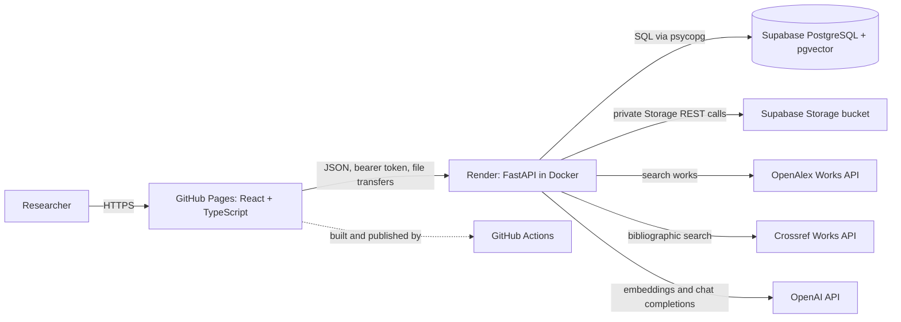

# Fieldnotes architecture and feature inventory

This document describes the application as implemented. It is the reference for the current system design, external services, API surface, and actions available to users; it is not a roadmap or the original project sketch.

## At a glance

Fieldnotes is a browser-based research workspace. The browser serves the React application and sends authenticated HTTPS requests to a FastAPI service. The API owns authentication, access checks, document processing, academic-search integration, retrieval, and AI calls. Research data and literature metadata are stored in PostgreSQL; original uploads are stored in a private file store.

## Architecture and hosting

| Layer | Technology/service | Responsibility |
|---|---|---|
| Web client | React 18, TypeScript, Vite | Login and registration, project workspace, document and paper views, and assistant review UI. |
| Static web hosting | GitHub Pages | Serves the built frontend at `https://grace-pasion.github.io/ai-research-assistant/`. It does not host the API, database, or documents. |
| Build and publish | GitHub Actions | Installs frontend dependencies, runs Vitest, builds the static site, and publishes it to Pages on pushes to `main` or a manual workflow run. `VITE_API_URL` can be overridden with a repository Actions variable; otherwise the workflow uses the configured Render API URL. |
| Admin portal | Separate React view at `?portal=admin` | Uses the same frontend bundle, but a separate login screen and isolated browser token. The backend grants administrator access only to existing accounts listed in `ADMIN_EMAILS`. |
| Backend API | Python 3.12, FastAPI, SQLAlchemy, Uvicorn, Docker | Provides the JSON API, bearer-token authentication, authorization, processing, storage access, and integrations. |
| API hosting | Render Web Service (Docker) | Runs the API. The service may sleep on the free plan; the health endpoint is `/api/health`. |
| Hosted database | Supabase PostgreSQL with the `vector` extension | Stores accounts, projects, document text/chunks and embeddings, conversations, usage counters, and literature metadata. The Render configuration uses `DATABASE_URL`; `LITERATURE_DATABASE_URL` defaults to the same URL unless separately configured. |
| Hosted file storage | Supabase Storage, private `research-documents` bucket | Stores original uploaded files. The API accesses the bucket using its server-side Supabase key; the browser does not access the bucket directly. |
| Local development | Docker Compose, PostgreSQL 16 with pgvector | Runs the Vite development server, API, and PostgreSQL. Local Compose initializes separate `research_db` and `literature_db` databases and stores uploads in a Docker volume. Local file storage is also supported. |

### Backend organization

- `backend/app/main.py` creates the FastAPI application, CORS policy, database engines/session factories, startup schema initialization, and route registration.
- `backend/app/routers/` implements authentication, administrator, projects, documents, papers, and assistant endpoints.
- `backend/app/services/` implements academic search, extraction/chunking, document processing, local/Supabase file storage, AI retrieval/generation, activity recording, and daily prompt limits.
- `backend/app/models.py` defines separate SQLAlchemy metadata for research data and literature data. The literature models use their own session factory even when both URLs point at the same physical PostgreSQL database.
- `backend/app/config.py` loads backend settings from environment variables (and `.env` for local development). OpenAI, database, JWT, and Supabase credentials belong on the backend, never in the frontend.

Document processing uses FastAPI in-process background tasks, not a durable external queue. Render runs Uvicorn with proxy-header support so the API can apply its client-IP prompt limit behind Render's proxy.

## External APIs and integrations

| Provider | API used | What Fieldnotes sends/receives |
|---|---|---|
| OpenAlex | `https://api.openalex.org/works` | Topic search and result metadata, including title, abstract, authors, year, DOI, venue, citation count, and landing-page URL. An optional `OPENALEX_EMAIL` identifies requests. |
| Crossref | `https://api.crossref.org/works` | Bibliographic query and result metadata, including DOI, title, abstract when available, authors, publication year, venue, and citation count. |
| OpenAI | Embeddings API and Chat Completions API, called through the Python SDK | Creates document/query embeddings and source-grounded assistant drafts. Default models are `text-embedding-3-small` and `gpt-4o-mini`, configurable on the backend. |
| Supabase | PostgreSQL connection and Storage object REST API | Stores relational/vector data and private original files. The Storage bucket is accessed only by the API using backend credentials. |
| GitHub | GitHub Actions and GitHub Pages | Builds/tests the frontend and hosts its static assets. GitHub is not the application database or document store. |
| Render | Docker Web Service | Hosts the API. Render is not the durable document store or database. |

Fieldnotes searches OpenAlex and Crossref; it does not scrape Google Scholar or call Semantic Scholar. Paper search is performed by the backend, not directly by the browser.

## Data model and persistence

- **Account data:** user email, display name, and password hash.
- **Research workspace:** user-owned projects; uploaded-document metadata, extracted text, processing status, and chunk records.
- **Document retrieval:** document chunks and 1,536-dimensional embeddings, queried with pgvector cosine distance.
- **Literature:** cached paper and author metadata, search-query history/results, and project-to-paper saved relationships.
- **Assistant history:** conversations, reviewed user/assistant messages, and ordered references to document chunks or saved papers. A conversation is created only after the user approves a draft.
- **Usage control:** a daily counter keyed by an HMAC hash of the client IP and UTC date. The raw client IP is not stored in that counter.
- **Activity history:** action type, timestamp, actor account, and a small set of non-content details. Events deliberately exclude document names/text, search terms, assistant questions, and generated answers. User events are removed when that account is hard-deleted.
- **Original files:** local files in development or private Supabase Storage objects in the hosted setup. PostgreSQL stores the storage path and metadata, not the file bytes.

The API enables PostgreSQL's `vector` extension and creates its tables at startup. In local Compose, the initialization script creates `research_db` and `literature_db`. In the hosted Blueprint, one Supabase `DATABASE_URL` is used for both model metadata sets by default; configure `LITERATURE_DATABASE_URL` only if a separate literature database is desired.

## Main data flows

### Upload and prepare a document

1. The signed-in user uploads a PDF, DOCX, TXT, or Markdown file to a project.
2. The API verifies project ownership, file type, non-empty content, and the configured upload-size limit, then writes the original to local storage or the private Supabase bucket.
3. An in-process background task extracts text. PDFs use PyMuPDF; DOCX uses `python-docx`; scanned PDF pages use Tesseract OCR.
4. Extracted text is split into overlapping chunks. When an OpenAI key is configured, the API creates embeddings and stores them with the chunks in PostgreSQL/pgvector. Without the key, extracted text can still be searched, but the document is marked as needing an API key for semantic retrieval.
5. The UI refreshes processing status and offers download, reprocess, and delete actions.

### Search and save academic papers

1. The user enters a query and chooses OpenAlex or Crossref.
2. The API calls the selected provider, normalizes returned bibliographic records, and stores paper/author metadata and search history.
3. The UI presents the available metadata, abstract, DOI, citation count, and an external paper link when provided.
4. The user can save a result to the current project or remove a saved paper later.

### Ask the research assistant

1. The user chooses **Ask a question**, **Compare sources**, or **Explore research gaps**, and enters a prompt.
2. The API checks authentication and project ownership, then enforces a limit of 20 assistant draft requests per client IP per UTC day. The quota is enforced atomically in PostgreSQL and excess requests receive HTTP 429 with a retry time.
3. The API retrieves up to six relevant ready document chunks using query embeddings and pgvector cosine distance. It also ranks the project's saved papers using query-term overlap and can include up to six relevant papers.
4. OpenAI receives the question, selected source excerpts, and (when continuing a conversation) recent conversation messages. The answer is instructed to cite supplied sources and not to treat source text as instructions.
5. The answer and source excerpts are returned as an **unsaved draft**. The user can discard it or approve it. A signed approval token is bound to the user and project and expires after 15 minutes.
6. Only approval stores the conversation, question, answer, and source references. Approval is idempotent.

The 20-request limit covers assistant drafts only. It does **not** limit embedding calls caused by upload or reprocessing, and it is not an OpenAI account-wide spending cap. People sharing one public IP share its quota; changing IP addresses can change the IP-based quota.

## User feature inventory

### Accounts and workspace access

- Create an account with name, email, and password; sign in and sign out.
- Keep an authenticated session in the browser using a bearer token. The backend validates signed tokens and checks that the current user owns the requested project.
- Use a private, account-scoped workspace. There is no multi-user project sharing in the current UI.

### Research projects

- Create a project with a name and optional description.
- Switch between the user's projects; see document and saved-paper counts for the selected project.
- Edit the project name and description.
- Delete a project and its associated research data and stored document files after confirmation.

### Documents

- Upload PDF, DOCX, TXT, or Markdown files to a project.
- View each file's size, upload date, processing state, and any processing error.
- Download the original file, retry processing when it is not already processing or ready, and delete it.
- Search extracted document text and inspect matching excerpts.
- Use OCR for scanned PDFs when Tesseract is available.
- Upload limit: 25 MB by default in the hosted configuration (backend setting permits configuration up to 100 MB); PDF extraction is limited to 100 pages.
- Continue to use extracted-text search when no OpenAI key is configured; embeddings and AI answers require the backend OpenAI key.

### Academic literature

- Search by topic, title, author, or DOI using OpenAlex or Crossref.
- Review returned bibliographic details and open an external paper link when supplied.
- Save papers to the current project, review the saved-paper list, and remove papers from it.

### Source-grounded assistant

- Ask research questions, compare saved sources, or explore possible research directions.
- Receive drafts with source citations/excerpts from the project's ready documents and saved papers.
- Continue an approved conversation and review its stored messages and citations.
- Discard an unapproved draft or explicitly approve it before the conversation is saved.
- Make at most 20 assistant draft requests per client IP per UTC day.

### Administrator console

- Sign in through the separate `?portal=admin` frontend with an existing account whose email is on the backend `ADMIN_EMAILS` allowlist. There is no public admin registration; the admin portal uses the same account password and stores its token separately from the researcher session.
- Review a paginated user list with join time, project/document/saved-paper/conversation counts, and last recorded activity.
- Review paginated metadata-only events for account creation/login, project changes, document upload/search/download/reprocess/delete, paper search/save/removal, assistant draft/approval, and administrator actions. Event records omit document names and contents, search terms, prompts, and answers. History begins when the feature is deployed; it is not reconstructed from earlier data.
- Permanently delete another user and their projects, documents, conversations, associated activity history, and original stored files. The current admin cannot delete their own account. If file deletion fails, the API reports an error and leaves the account in place.

## HTTP API surface

Routes require a bearer token except health, registration, and login routes. They are served by the Render API and called by the frontend.

| Method | Route | Purpose |
|---|---|---|
| `GET` | `/api/health` | Health check. |
| `POST` | `/api/auth/register` | Register an account and return a token. |
| `POST` | `/api/auth/login` | Sign in and return a token. |
| `GET` | `/api/auth/me` | Return the authenticated user's profile. |
| `POST` | `/api/admin/auth/login` | Sign in through the separate admin portal; account email must be allowlisted. |
| `GET` | `/api/admin/me` | Return the current administrator profile. |
| `GET` | `/api/admin/users?limit=...&offset=...` | List paginated account summaries and activity timestamps. |
| `GET` | `/api/admin/activity?user_id=...&limit=...&offset=...` | List paginated activity metadata, optionally for one user. |
| `DELETE` | `/api/admin/users/{user_id}` | Permanently delete another user and their associated data/files. |
| `GET`, `POST` | `/api/projects` | List or create the authenticated user's projects. |
| `PATCH`, `DELETE` | `/api/projects/{project_id}` | Edit or delete an owned project. |
| `GET` | `/api/projects/{project_id}/documents` | List project documents and processing states. |
| `GET` | `/api/projects/{project_id}/documents/search?q=...` | Search extracted text in a project. |
| `POST` | `/api/projects/{project_id}/documents` | Upload a document. |
| `GET` | `/api/documents/{document_id}/download` | Download the original document. |
| `POST` | `/api/documents/{document_id}/reprocess` | Reprocess an owned document. |
| `DELETE` | `/api/documents/{document_id}` | Delete an owned document and its stored file. |
| `GET` | `/api/projects/{project_id}/papers` | List papers saved to a project. |
| `GET` | `/api/projects/{project_id}/papers/search?q=...&provider=...` | Search OpenAlex or Crossref. |
| `POST`, `DELETE` | `/api/projects/{project_id}/papers/{paper_id}/save` | Save or remove a paper from a project. |
| `GET` | `/api/projects/{project_id}/assistant/conversations` | List approved conversations for a project. |
| `GET` | `/api/projects/{project_id}/assistant/conversations/{conversation_id}` | Read an approved conversation and its sources. |
| `POST` | `/api/projects/{project_id}/assistant/draft` | Generate an unsaved, rate-limited assistant draft. |
| `POST` | `/api/projects/{project_id}/assistant/approve` | Validate a review token and save the approved conversation. |

Interactive API documentation is available at `/docs` on the API host.

## Security, configuration, and operating limits

- Passwords are hashed; API access uses signed HS256 bearer tokens. Project and document operations perform ownership checks.
- Administrator access is checked on every admin request against the server-side, comma-separated `ADMIN_EMAILS` allowlist. The admin interface is separate, but the allowlisted user signs in with their existing account credentials. Removing an email from the allowlist revokes admin access after the backend restarts/redeploys.
- Activity logging is metadata-only by design. It does not record file names or contents, search terms, assistant prompts, or generated answers. User activity history is cascade-deleted with the user account.
- API credentials and signing secrets are backend environment variables. The browser receives only the public API base URL.
- CORS allows the configured web origin; the hosted Render configuration allows `https://grace-pasion.github.io`.
- Supabase Storage is configured as a private bucket. The API accesses files server-to-server.
- The hosted backend defaults to `gpt-4o-mini` for chat and `text-embedding-3-small` for embeddings. OpenAI calls can incur charges.
- The assistant IP quota is separate from document embeddings; OpenAI's own usage limits and billing controls should also be configured.
- The Render and Supabase free tiers can sleep, pause, or impose storage/usage limits. They are suitable for demos, not a guaranteed production or backup strategy.
- Processing runs in the API process. It is not a persistent queue, so long-running tasks are subject to the hosting service's runtime lifecycle.
