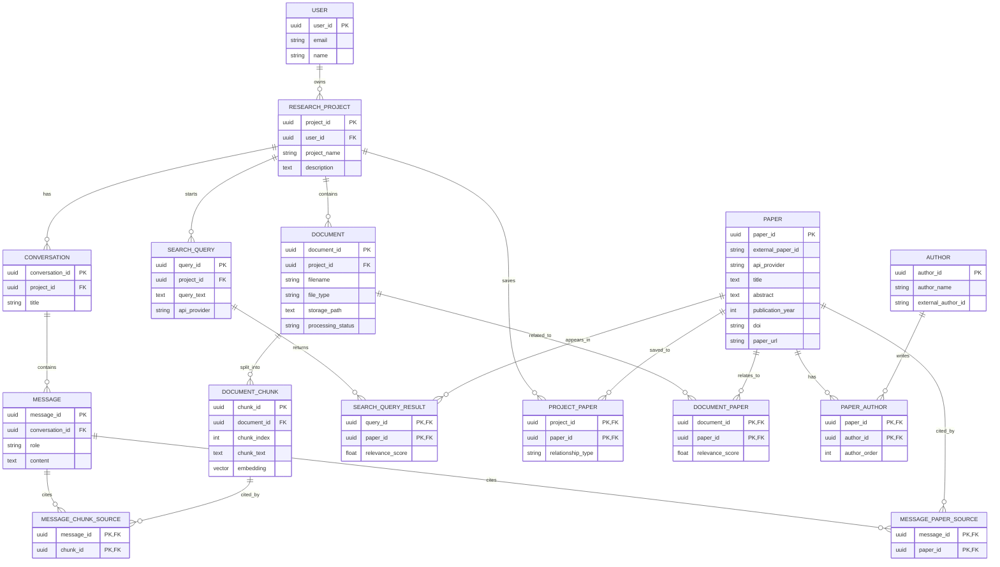
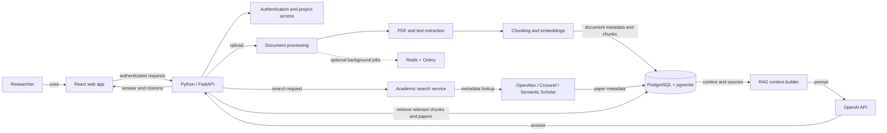

# AI Research Assistant

> **Project snapshot — November 17, 2026**<br>
> An initial plan for a web app that helps researchers keep their materials together, find relevant academic work, and explore a topic with AI.

## Purpose and goals

Research often means juggling PDFs, search results, and notes across different tools. This project aims to bring those tasks into one workspace:

- **Organize research:** upload documents and group them into research projects.
- **Discover literature:** search academic sources and save useful papers.
- **Ask grounded questions:** get answers based on uploaded documents and papers, with sources to follow up on.
- **Explore a topic:** compare literature and surface possible research gaps or next directions.

**First milestone:** a usable web-app prototype for managing documents, searching papers, and asking source-backed questions. The diagrams and feature scope below are initial sketches and may change as the project develops.

## Initial data model

The sketch separates user-owned research data from reusable academic literature metadata. They may be logical schemas in one PostgreSQL deployment; the physical database setup is still to be decided.



## Rough system design

The stack follows the initial proposal: React, Python/FastAPI, PostgreSQL with pgvector, academic search APIs, and an LLM API. Redis/Celery is shown as an option for slower document-processing jobs.



**Typical question flow:** the user asks a question in the web app; the API checks access, retrieves relevant document chunks and saved papers, sends grounded context to the LLM, and returns an answer with sources.

## Initial daily goals

An initial **10-work-session** sequence, sized for roughly **30–40 project hours**. Follow it across the remaining class days; combine sessions if the course calendar is shorter.

| Day | Goal |
|---|---|
| 1 | Confirm the minimum viable feature set, user flow, and technology choices. |
| 2 | Set up the app skeleton and initial PostgreSQL schema. |
| 3 | Build research-project and document upload/listing flows. |
| 4 | Extract document text; add chunking and embedding storage. |
| 5 | Integrate one academic search provider and save paper metadata. |
| 6 | Retrieve relevant document chunks and papers for a question. |
| 7 | Generate answers with source references and retain conversation history. |
| 8 | Connect the main React screens to the API; refine the core user flow. |
| 9 | Test the end-to-end flow, handle errors, and fix the most important issues. |
| 10 | Prepare a demo, finish concise setup/use documentation, and identify next steps. |

## Optional UX sketch

```text
+----------------------+------------------------------------+
| Projects             | Project: Climate adaptation        |
|  + New project       |                                    |
|  Climate adaptation  | [Documents] [Papers] [Ask]          |
|  Other project       |                                    |
|                      | Ask about this research...           |
|                      | [________________________________]   |
|                      |                                    |
|                      | Answer with linked document and     |
|                      | paper sources                       |
+----------------------+------------------------------------+
```
