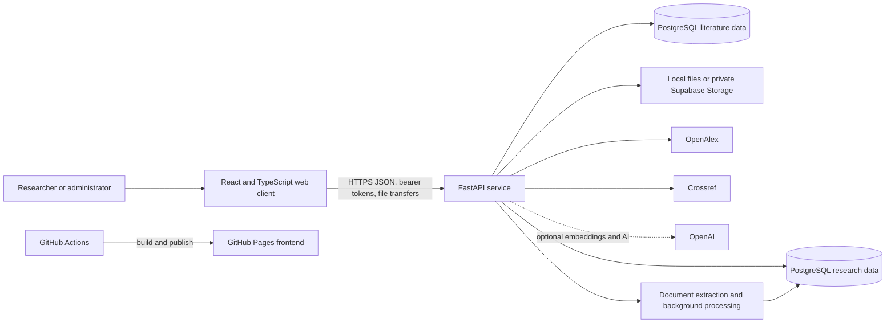
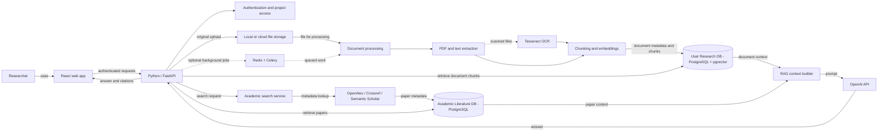

# Fieldnotes project overview

> **Current implementation snapshot — November 22, 2026**

Fieldnotes is a browser-based research workspace for organizing projects and source material, discovering academic literature, and asking source-grounded questions. This page summarizes the implemented system. See [README.md](./README.md) for setup and usage, and [ARCHITECTURE.md](./ARCHITECTURE.md) for the complete feature inventory, API surface, data model, and detailed flows.

## Current features

- **Accounts and settings:** register and sign in; manage a username, display name, profile picture, and password. AI usage and document-processing status are on a separate settings page.
- **Research projects and collaboration:** organize documents and papers into projects; invite registered colleagues; share project material; receive invitations and direct messages through the inbox.
- **Documents and annotations:** upload PDF, DOCX, TXT, or Markdown files; extract text, OCR scanned PDFs, search project text, and add persistent notes or highlights to documents and saved-paper abstracts.
- **Academic literature:** search OpenAlex and Crossref; save and screen papers; import/export RIS and BibTeX; import OpenAlex-confirmed open-access PDFs for full-text search and assistant retrieval.
- **Research assistant:** ask questions, compare sources, explore research directions, and search for papers. Responses include source citations and evidence excerpts; reviewed drafts must be approved before they are saved.
- **Research outputs:** export approved source comparisons as editable cited Word briefs and work in a per-project LaTeX workspace with `main.tex` and `references.bib`.
- **Administration:** use a separate allowlisted administrator portal to review metadata-only activity and manage accounts.

## Implemented architecture



- The frontend is a static React application. GitHub Pages hosts the public web bundle; a separate `?portal=admin` view uses the same bundle with a separate login and browser token.
- The FastAPI backend handles authentication, authorization, project collaboration, file access, document processing, academic search, retrieval, and AI requests. API credentials and database secrets stay on the backend.
- PostgreSQL stores account, project, document, annotation, collaboration, conversation, usage, and activity data. Literature metadata uses separate SQLAlchemy metadata and can use the same physical PostgreSQL database or a separately configured URL. pgvector stores document embeddings.
- Original uploads are held in local storage during development or in a private Supabase Storage bucket when hosted. The API mediates file access.
- The API extracts PDFs with PyMuPDF, DOCX with `python-docx`, and scanned PDF pages with Tesseract OCR. Processing and embedding tasks run in the API process; there is no durable external job queue.
- OpenAlex and Crossref provide literature metadata. OpenAI is optional for semantic ranking, embeddings, and assistant answers. Without an OpenAI key, academic search, file upload, extraction, and text search remain available.
- Local development uses Docker Compose. The hosted setup uses GitHub Pages, Render for the API, and Supabase PostgreSQL and private object storage.

## Important limits and safeguards

- Assistant drafts are limited to 50 requests per client IP per UTC day. Estimated embedding use is limited to 50,000 tokens per account per UTC day by default and can be configured with `DAILY_EMBEDDING_TOKEN_LIMIT`.
- Bulk uploads accept up to 20 files per request; the default per-file upload limit is 25 MB, and PDF extraction is limited to 100 pages.
- Passwords are stored as one-way hashes. New passwords must be 12-128 characters; researcher and administrator sign-in attempts are throttled.
- Project access is checked by the API. Accepted collaborators share project content, but assistant conversations remain private to their author. Administrative access is controlled by the backend `ADMIN_EMAILS` allowlist.
- Assistant evidence checks reduce unsupported claims but cannot guarantee correctness. Review the cited passages before approving and saving a response.

## Historical project proposal

The sections below preserve the original planning sketch from November 17, 2026. They are historical context, not a description of the current data model or deployment.

### Original purpose and goals

Research often means juggling PDFs, search results, and notes across different tools. This project aims to bring those tasks into one workspace:

- **Organize research:** upload documents and group them into research projects.
- **Discover literature:** search academic sources and save useful papers.
- **Ask grounded questions:** get answers based on uploaded documents and papers, with sources to follow up on.
- **Explore a topic:** compare literature and surface possible research gaps or next directions.

**First milestone:** a usable web-app prototype for managing documents, searching papers, and asking source-backed questions. The diagrams and feature scope below are initial sketches and may change as the project develops.

### Initial data model (superseded)

The sketch separates user-owned research data from reusable academic literature metadata. Both may use PostgreSQL in one deployment; uploaded files live in separate local or cloud file storage.


### Initial system-design sketch (superseded)

The stack follows the initial proposal: React, Python/FastAPI, PostgreSQL with pgvector, academic search APIs, and an LLM API. Original uploads go to local or cloud file storage; Tesseract OCR can extract text from scanned files. Redis/Celery is an option for slower document-processing jobs.



**Typical question flow:** the user asks a question in the web app; the API checks access, retrieves relevant document chunks and saved papers, sends grounded context to the LLM, and returns an answer with sources.

### Original project schedule

Daily goals for **November 18–December 2, 2026** (15 days), at roughly **2–2.5 hours per day** or **30–40 project hours** total.

| Day | Goal |
|---|---|
| Nov 18 | Confirm the MVP, user flow, and technology choices; prepare the development environment. |
| Nov 19 | Set up the application skeleton and map the ERD into PostgreSQL tables. |
| Nov 20 | Implement the initial API and database connection; start the React app shell. |
| Nov 21 | Build research-project and document upload/listing flows; save files outside the database. |
| Nov 22 | Extract text from PDFs and text files; try OCR for scanned documents. |
| Nov 23 | Chunk extracted text, generate embeddings, and store/search them with pgvector. |
| Nov 24 | Integrate one academic search provider and save paper metadata and authors. |
| Nov 25 | Add search history and let users save relevant papers to a research project. |
| Nov 26 | Persist conversations and messages; retrieve relevant document and paper sources. |
| Nov 27 | Generate grounded AI answers and return citations to their sources. |
| Nov 28 | Connect the React project, documents, papers, and chat views to the API. |
| Nov 29 | Refine the core user flow and add background document processing if needed. |
| Nov 30 | Test the end-to-end flow, access controls, upload handling, and error states. |
| Dec 1 | Fix priority issues; prepare sample research data and a demo walkthrough. |
| Dec 2 | Demo the prototype, finish setup/use documentation, and capture next steps. |

### Original UX sketch

```text
+----------------------+------------------------------------+
| Projects             | Project: Climate adaptation        |
|  + New project       |                                    |
|  Climate adaptation  | [Documents] [Papers] [Ask]          |
|  Other project       |                                    |
|                      | Ask about this research...           |
|                      | [________________________________]   |
|                      |                                    |
|                      | Answer with linked document and     |
|                      | paper sources                       |
+----------------------+------------------------------------+
```
