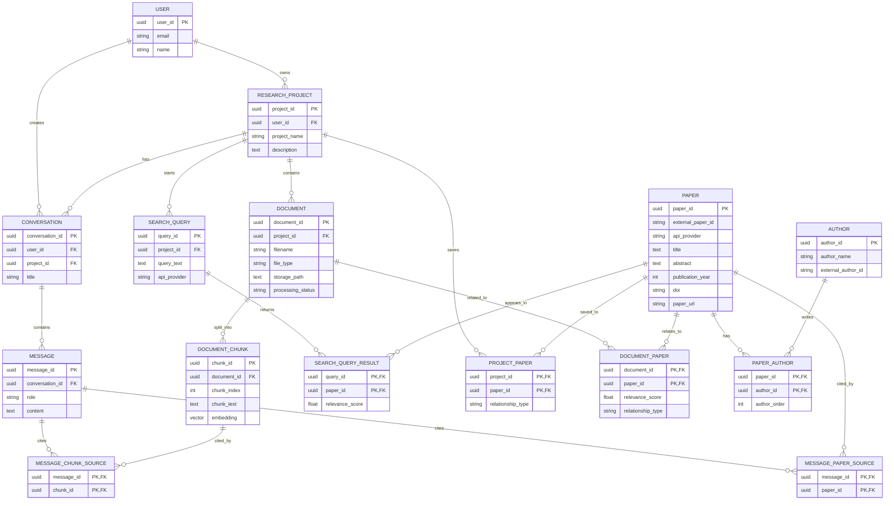
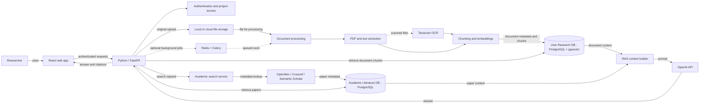

# AI Research Assistant

> **Project snapshot — November 17, 2026**<br>
> An initial plan for a web app that helps researchers keep their materials together, find relevant academic work, and explore a topic with AI.

## Purpose and goals

Research often means juggling PDFs, search results, and notes across different tools. This project aims to bring those tasks into one workspace:

- **Organize research:** upload documents and group them into research projects.
- **Discover literature:** search academic sources and save useful papers.
- **Ask grounded questions:** get answers based on uploaded documents and papers, with sources to follow up on.
- **Explore a topic:** compare literature and surface possible research gaps or next directions.

**First milestone:** a usable web-app prototype for managing documents, searching papers, and asking source-backed questions. The diagrams and feature scope below are initial sketches and may change as the project develops.

## Initial data model

The sketch separates user-owned research data from reusable academic literature metadata. Both may use PostgreSQL in one deployment; uploaded files live in separate local or cloud file storage.



## Rough system design

The stack follows the initial proposal: React, Python/FastAPI, PostgreSQL with pgvector, academic search APIs, and an LLM API. Original uploads go to local or cloud file storage; Tesseract OCR can extract text from scanned files. Redis/Celery is an option for slower document-processing jobs.



**Typical question flow:** the user asks a question in the web app; the API checks access, retrieves relevant document chunks and saved papers, sends grounded context to the LLM, and returns an answer with sources.

## Initial daily goals

Daily goals for **November 18–December 2, 2026** (15 days), at roughly **2–2.5 hours per day** or **30–40 project hours** total.

| Day | Goal |
|---|---|
| Nov 18 | Confirm the MVP, user flow, and technology choices; prepare the development environment. |
| Nov 19 | Set up the application skeleton and map the ERD into PostgreSQL tables. |
| Nov 20 | Implement the initial API and database connection; start the React app shell. |
| Nov 21 | Build research-project and document upload/listing flows; save files outside the database. |
| Nov 22 | Extract text from PDFs and text files; try OCR for scanned documents. |
| Nov 23 | Chunk extracted text, generate embeddings, and store/search them with pgvector. |
| Nov 24 | Integrate one academic search provider and save paper metadata and authors. |
| Nov 25 | Add search history and let users save relevant papers to a research project. |
| Nov 26 | Persist conversations and messages; retrieve relevant document and paper sources. |
| Nov 27 | Generate grounded AI answers and return citations to their sources. |
| Nov 28 | Connect the React project, documents, papers, and chat views to the API. |
| Nov 29 | Refine the core user flow and add background document processing if needed. |
| Nov 30 | Test the end-to-end flow, access controls, upload handling, and error states. |
| Dec 1 | Fix priority issues; prepare sample research data and a demo walkthrough. |
| Dec 2 | Demo the prototype, finish setup/use documentation, and capture next steps. |

## Optional UX sketch

```text
+----------------------+------------------------------------+
| Projects             | Project: Climate adaptation        |
|  + New project       |                                    |
|  Climate adaptation  | [Documents] [Papers] [Ask]          |
|  Other project       |                                    |
|                      | Ask about this research...           |
|                      | [________________________________]   |
|                      |                                    |
|                      | Answer with linked document and     |
|                      | paper sources                       |
+----------------------+------------------------------------+
```
